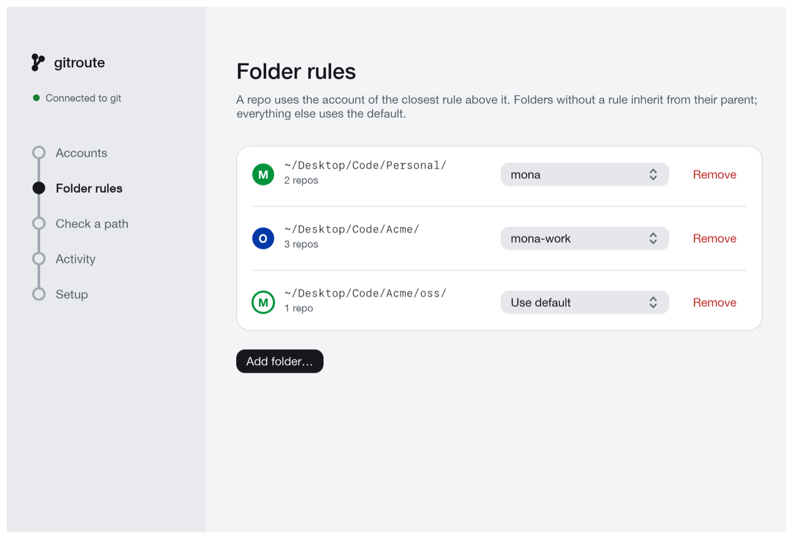
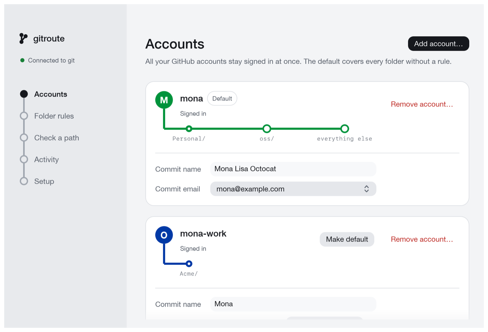
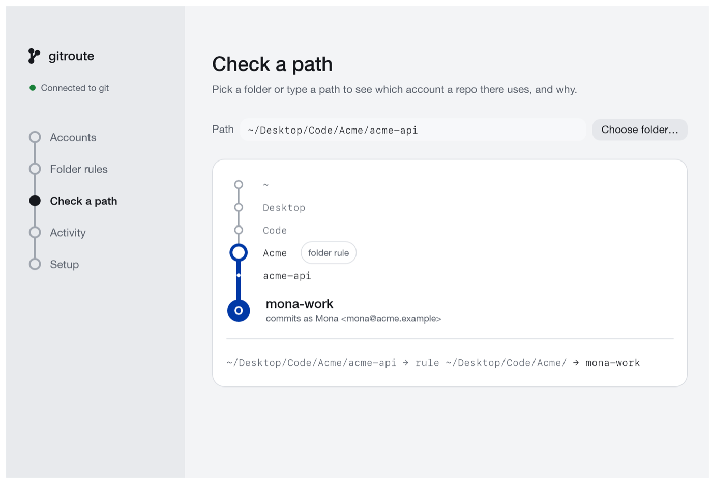
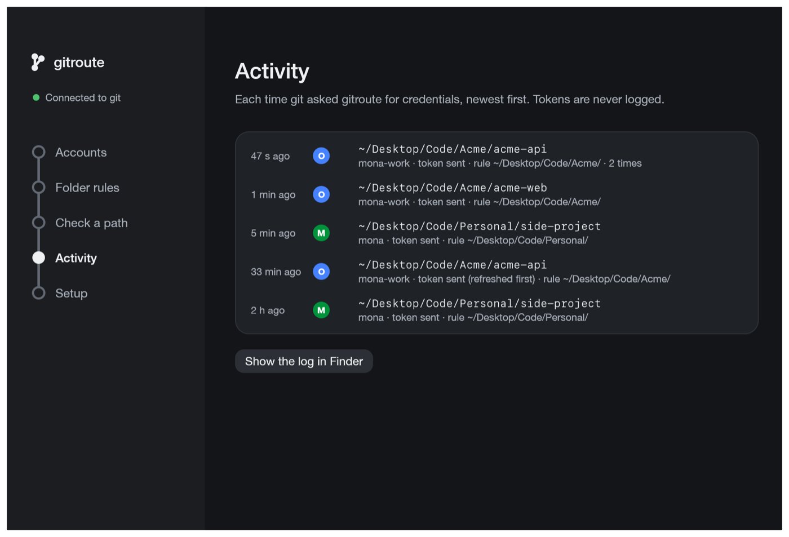

<p align="center"></p>

# gitroute

A macOS menu bar app that keeps several GitHub accounts signed in at once and
picks the right one for every git operation, based on the folder the repo is
in. Work repos push as your work account, everything else as your personal
one, with no SSH host aliases, `insteadOf` tricks or keychain juggling.



- **Folder rules.** `~/Code/Acme/` → work account, everything else → the
  default. The closest rule above a repo wins, so a subfolder can have its own.
- **Right token, every time.** git asks gitroute for github.com credentials over
  HTTPS and gets the token of the account that folder belongs to. It never
  prompts.
- **Right identity.** Commits in a routed folder carry that account's name and
  email.
- **Explains itself.** *Check a path* shows which account a repo uses and why;
  *Activity* lists every time git asked; *Setup* runs checks on your git
  settings.

## Install

There's no prebuilt download yet, so you build it from source. You need macOS 12
or later, [Rust](https://rustup.rs) and the Xcode Command Line Tools
(`xcode-select --install`).

```sh
git clone https://github.com/AmanKumarVerma11/gitroute.git
cd gitroute
./scripts/bundle.sh
cp -R dist/gitroute.app /Applications/
open /Applications/gitroute.app
```

gitroute lives in the menu bar (look for the branch icon). It has no Dock icon.
Closing the window keeps it running; *Quit gitroute* is in the menu.

## First run

1. **Setup → Install…** gitroute shows you the exact change to your
   `~/.gitconfig` (one marked block at the end), backs the file up, and only
   then writes it.
2. **Accounts → Add account…** You get a code and sign in on github.com in your
   browser. gitroute never sees your password. Before adding a second account,
   sign out of github.com in your browser first, or use a private window, so
   GitHub asks which account to approve.
3. **Folder rules → Add folder…** Pick a folder and choose its account. Every
   repo inside it, now or cloned later, uses that account.
4. **Check a path** to confirm a repo resolves the way you expect.



| | |
|---|---|
|  |  |

Then use git as usual, with HTTPS remotes (`https://github.com/owner/repo.git`).

## How it works

gitroute adds one block at the end of your global gitconfig:

```ini
# >>> gitroute (managed, do not edit)
[include]
	path = ~/.config/gitroute/gitconfig
# <<< gitroute
```

and keeps the file it points at in step with your accounts and rules:

```ini
[user]                                  # the default account
	name = "Mona Lisa Octocat"
	email = "mona@example.com"

[credential "https://github.com"]
	helper =                            # drops helpers set earlier for github.com, such as osxkeychain
	helper = "/Applications/gitroute.app/Contents/MacOS/git-credential-gitroute"

[includeIf "gitdir/i:/Users/mona/Code/Acme/"]
	path = "/Users/mona/.config/gitroute/identities/2002.gitconfig"   # mona-work's name and email
```

Two things happen when git talks to github.com from a repo:

- **Credentials.** git runs `git-credential-gitroute`, a small credential
  helper inside the app. It looks at which repo git is working in, finds the
  closest folder rule above it (or the default account), and answers with that
  account's token. It ignores every host except `https://github.com`.
- **Commit identity.** git reads the `includeIf` for the folder and takes that
  account's name and email. Deeper folders come later in the file, so the
  closest rule wins, just as it does for credentials.

Rules match whole folder names. They ignore letter case (macOS folders do too)
and follow symlinks. A rule set to *Use default* carves a subfolder out of a
parent rule.

### Tokens

Signing in uses GitHub's device flow with gitroute's OAuth App. Tokens are kept
in your login Keychain (service `gitroute`), never in a file. When GitHub issues
tokens that expire, gitroute refreshes them before handing them to git. If GitHub
rejects a token, the account is marked *Needs re-login* and the app shows a
button to sign in again.

gitroute asks for the scopes `repo` and `workflow` (push and pull, including
changes to GitHub Actions workflows) plus `read:user` and `user:email` (your
login and verified emails, to offer as commit emails).

## Command line

The app bundle also contains a `gitroute` command that reads and writes the same
config:

```sh
alias gitroute=/Applications/gitroute.app/Contents/MacOS/gitroute
```

| Command | What it does |
|---|---|
| `gitroute status` | Setup, accounts, rules with the repos they cover, recent decisions |
| `gitroute which [path]` | Which account a path uses, and why |
| `gitroute doctor` | The checks from the Setup page; exits 1 if something needs attention |
| `gitroute rule add <folder> <login\|default>` | Route a folder; `rule rm`, `rule ls` |
| `gitroute default <login>` | Make an account the default |
| `gitroute login` / `logout <login>` / `accounts` | Manage accounts |
| `gitroute install` / `uninstall` | Add or remove the gitconfig block, after showing the diff |

## Troubleshooting

**Run the checks first.** *Setup* (or `gitroute doctor`) lists git settings
outside gitroute that affect it: your own `includeIf` rules, other credential
helpers, and URL rewrites. gitroute never edits settings it didn't write; it
tells you what to change.

**An organization's repo says "Repository not found" (or 403).** The
organization restricts which OAuth Apps can access it. Ask an owner to approve
gitroute: on github.com go to **Settings → Applications → Authorized OAuth
Apps → gitroute**, then click **Request access** next to the organization.
Until an owner approves it, gitroute's token can't reach that organization's
repos.

**SSH remotes aren't affected.** git never asks a credential helper over SSH. Check
with `git remote -v`, and switch a repo to HTTPS with
`git remote set-url origin https://github.com/owner/repo.git`. A `url.*.insteadOf`
rewrite that sends `https://github.com/` to SSH has the same effect; the checks
flag it.

**Commits have the wrong email.** Run `gitroute which` inside the repo, and
`git config user.email` to see what git actually uses. A `[user]` section after
gitroute's block, or in the repo's own `.git/config`, overrides gitroute.

**Logs.** Each request is logged, without tokens, to
`~/Library/Logs/gitroute/helper.log`. *Activity → Show the log in Finder*
opens it.

## Files gitroute touches

| Path | What |
|---|---|
| `~/.gitconfig` (or `$GIT_CONFIG_GLOBAL`) | One marked block at the end; backed up before every change |
| `~/.config/gitroute/` | The generated gitconfig, one identity file per account, backups |
| `~/Library/Application Support/gitroute/config.toml` | Accounts (no tokens), default account, folder rules |
| `~/Library/Logs/gitroute/helper.log` | What the credential helper decided, without tokens |
| Keychain, service `gitroute` | One token per account |

gitroute connects only to `github.com` and `api.github.com`, to sign in, refresh
tokens and read your login and emails. It sends no analytics.

### Uninstall

*Setup → Uninstall…* (or `gitroute uninstall`) removes the block from your
gitconfig. Remove each account under *Accounts* to delete its token, then quit
the app and delete `gitroute.app`, `~/.config/gitroute` and
`~/Library/Application Support/gitroute`.

## Development

| Crate | What it is |
|---|---|
| `crates/gitroute-core` | Config, rule resolver, GitHub API, token store, gitconfig writer, checks |
| `crates/git-credential-gitroute` | The credential helper git runs |
| `crates/gitroute-cli` | The `gitroute` command |
| `crates/gitroute-app` | Menu bar app and settings window (egui) |

```sh
cargo test                                               # never touches your real config or Keychain
cargo test -p gitroute-app render_screens -- --ignored   # screenshots of every page to target/screens/
./scripts/icon.sh                                        # regenerate assets/gitroute.icns
```

### Release builds

```sh
./scripts/bundle.sh --universal   # dist/gitroute.app for Apple silicon and Intel
./scripts/dmg.sh                  # dist/gitroute-<version>.dmg
```

Both sign ad hoc by default, which is fine for your own Mac. A download for
other people needs a Developer ID and Apple's notarization, or macOS blocks it.
Save notarization credentials once with
`xcrun notarytool store-credentials <profile>`, then:

```sh
export GITROUTE_SIGN_IDENTITY="Developer ID Application: Your Name (TEAMID)"
export GITROUTE_NOTARY_PROFILE=<profile>
./scripts/bundle.sh --universal && ./scripts/dmg.sh
```

`bundle.sh` signs with the hardened runtime and a secure timestamp. `dmg.sh`
signs the disk image, submits it for notarization, waits, and staples the
ticket.

## License

MIT
